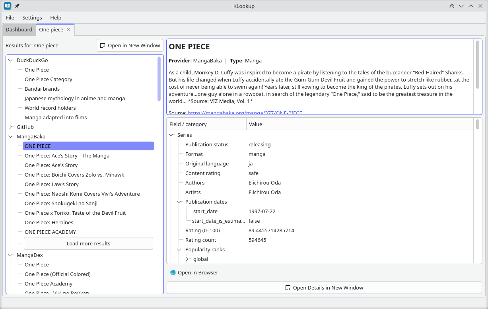
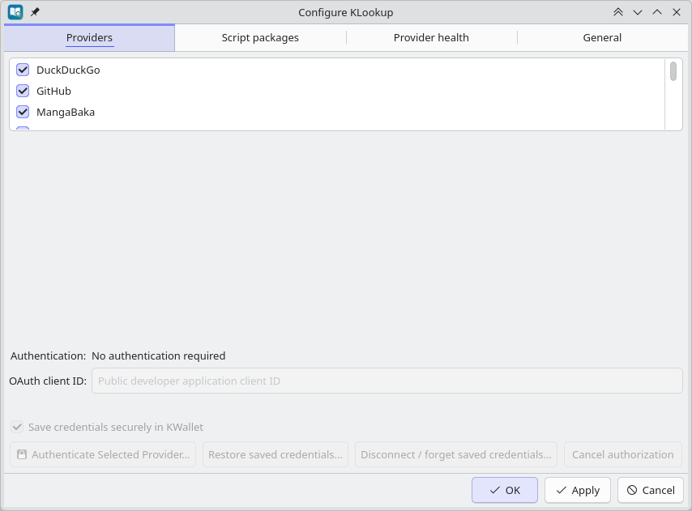
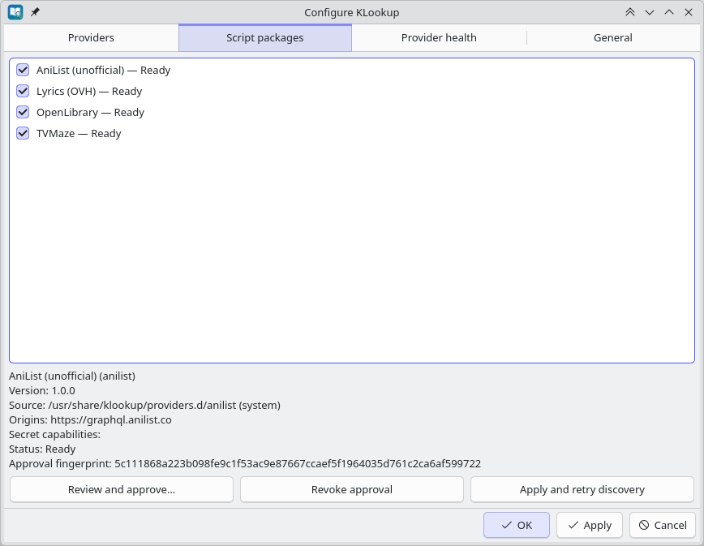
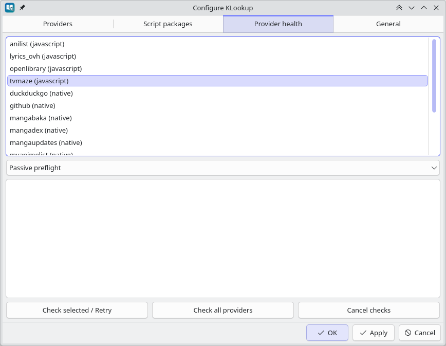
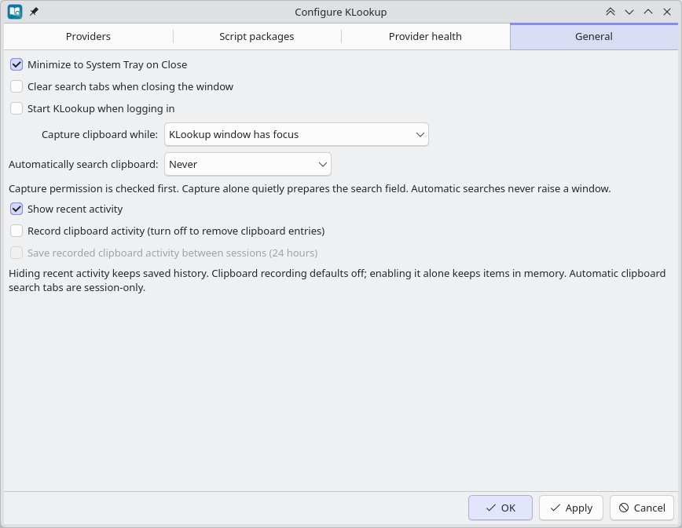
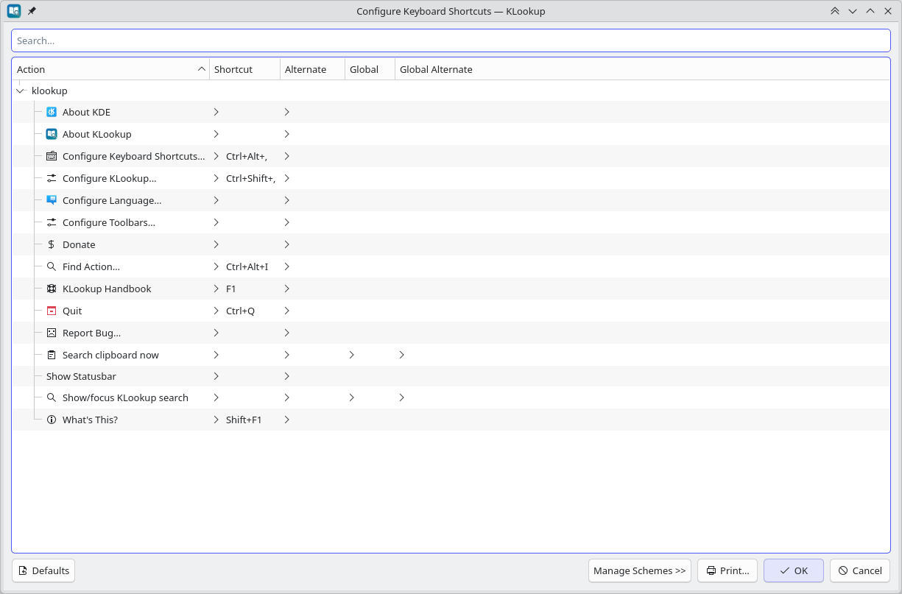
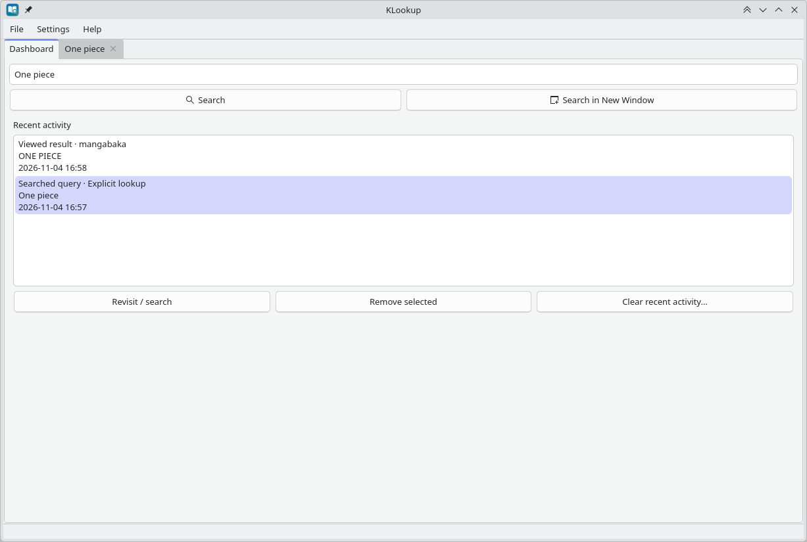

<p align="center">
  
</p>

# KLookup

**Look something up, not somewhere else.** KLookup brings specialised search sources together in a native **KDE Plasma 6** desktop application. Search once, explore results from multiple providers, read available details, and open a source website only when you need to.

Find encyclopaedia articles, books, software projects, films, shows, music, anime, manga and PC-game deals without repeating a search in a dozen browser tabs.

KLookup is designed around **focused lookups**: rather than trying to become another browser or a full web search engine, it asks dedicated information sources for relevant results and presents them together.

> **Project status:** KLookup can be built from source, but [v0.0.2](https://github.com/arran4/klookup/releases/tag/v0.0.2) is published, including a Linux amd64 release archive. Some features described under [Planned improvements](#planned-improvements) are **not yet implemented**.

## At a glance

| If you want to… | KLookup helps you… |
| --- | --- |
| Check a concept, title or name | Search enabled encyclopaedia and catalogue sources together |
| Research a library or project | Find matching GitHub repositories, with links back to GitHub |
| Explore a film, album, book or series | Compare catalogue entries and inspect the details those services provide |
| Keep references open while you work | Use search tabs, separate windows and detachable result details |
| Start a lookup without opening the app first | Use KRunner or a configurable Plasma global shortcut |
| Limit what leaves your computer | Choose providers, disable clipboard capture, and explicitly control authentication |

### Why KLookup?

- **Less context switching.** Enter one query and examine results from different specialised sources in a single desktop window.
- **Keep the structure of the source.** Where supported, results include descriptions, metadata, related categories and further detail on demand rather than a list of bare links.
- **Stay in control.** Enable only the providers you want. Some work without accounts; others can be connected through their own authentication flows.
- **Follow your own workflow.** Keep several searches in tabs; split work between windows; use a result's original URL when you need the full website.
- **Integrate with KDE.** Launch searches through KRunner, configure global shortcuts and optionally keep the application in the system tray.
- **Privacy choices are visible.** Clipboard monitoring and automatic clipboard searches are opt-in and configured separately.

## Screenshots — current interface (November 2026)

These images were captured from **KLookup running on KDE Plasma 6** (November 2026). They document what the application looks like and does **today**, rather than illustrating proposed features. The user interface will continue to evolve as work on [resizable panes](https://github.com/arran4/klookup/issues/136), [results presentation](https://github.com/arran4/klookup/issues/134) and [settings layout](https://github.com/arran4/klookup/issues/137) progresses.

### Search results and source details

[](docs/images/klookup-search-results.webp)

*Searching for “One piece”: provider-grouped matches on the left, with the selected MangaBaka summary, source URL, and structured detail tree on the right.*

### Providers and plugins

| Native provider settings | Script packages |
| --- | --- |
| [](docs/images/klookup-provider-settings.webp) | [](docs/images/klookup-script-packages.webp) |
| Native lookup providers can be enabled or disabled individually | JavaScript providers with source paths, permissions, status, and approval controls |

KLookup supports both native C++ lookup plugins and JavaScript script packages (`.mjs`) loaded from `providers.d` directories. Native sources can be toggled on or off individually. Script packages require explicit user review and approval (verifying source location, declared origin permissions, and package fingerprint) before execution, displaying their readiness status and offering revoke or retry controls. Note that scripted KWallet credential provisioning remains incomplete ([#85](https://github.com/arran4/klookup/issues/85)); shipped script packages require no credentials.

### Provider diagnostics

[](docs/images/klookup-provider-health.webp)

*Provider health diagnostics: inspect native and scripted provider readiness, run passive preflights or explicit checks, and view diagnostic status.*

The **Provider health** tab allows diagnosing both native and scripted providers. Passive preflight checks inspect provider registration and configuration without sending network traffic or requesting wallet access, while explicit checks can be run on demand to report status, unsupported operations, or connectivity failures.

### Settings and integration

| General preferences | Keyboard shortcuts |
| --- | --- |
| [](docs/images/klookup-general-settings.webp) | [](docs/images/klookup-keyboard-shortcuts.webp) |
| Tray behavior, clipboard capture policies, automatic search, and recent activity options | Application actions and configurable Plasma global shortcuts |

Clipboard monitoring and automatic searches are strictly controlled by user preferences and are turned off by default. Configurable Plasma global shortcuts (such as raising search or looking up clipboard content) are opt-in and unassigned by default, ensuring existing desktop hotkeys are never overridden without user configuration.

<details>
<summary>Recent activity dashboard</summary>

[](docs/images/klookup-recent-activity.webp)

*Recent activity after a search and result selection, showing the query, timestamp, and viewed item with options to revisit, remove, or clear history.*

</details>

All screenshots depict KLookup itself running on KDE Plasma; external third-party website interfaces are not included.

## Getting started

### 1. Install or build KLookup

If you have a distribution package, use the package's normal installation procedure. Otherwise, follow [Build from source](#build-from-source) below. GitHub [releases](https://github.com/arran4/klookup/releases) include a Linux amd64 archive. Check its compatibility with your distribution; Gentoo users can install from the separate [arrans_overlay](https://github.com/arran4/arrans_overlay) source ebuild once it has been updated to the desired release.

The installed application should be available as **KLookup** from your KDE application launcher, or as `klookup` from a terminal.

### 2. Run your first search

1. Open **KLookup** to see the dashboard.
2. Type a title, word, phrase or topic — for example, **KDE Plasma**, **Pride and Prejudice**, or **Spirited Away**.
3. Select **Search**. KLookup asks the enabled providers and displays their matches in source-specific groups.
4. Choose a result to read its description and the information the provider supplies.
5. Where available, select **Load full details** for additional information or **Load more results** to retrieve more matches.
6. Use **Open in Browser** or the result context menu when you want the original website, or copy the title/source URL for later.

Each provider has its own catalogue and matching rules. Searching a topic does not guarantee that every source will return something, and a search provider is not necessarily a general-purpose web engine.

### 3. Keep researching

- Start a **new search** to preserve your earlier query in another tab.
- Choose **Search in New Window** from the dashboard to work with two searches side by side.
- Right-click an existing search tab to open that search in its own window.
- Use **Open Details in New Window** for a selected result you want to leave visible.
- Return to recent searches or viewed results through the dashboard's **Recent activity** area, when enabled.

KLookup can restore query tabs between application sessions. Result history, autocomplete and clipboard-capture activity have separate privacy and retention behaviour; see [History and clipboard controls](#history-and-clipboard-controls).

## Example uses

### Look up a term while writing or reading

Search a subject in **Wikipedia** and examine related entries. If you only need a short answer, **DuckDuckGo's Instant Answer API** may have a relevant match. KLookup is not currently an offline dictionary and **does not yet pop up definitions merely because you highlight a word**; that is a planned StarDict-inspired workflow.

### Compare books and media catalogues

Find a book via **Open Library**, or search a film/show in **TMDb**, **OMDb** and **TVMaze**. You can compare the available entries, follow the upstream links and keep results open while researching.

### Explore anime, manga and related works

Search across **AniList**, **MyAnimeList (Jikan)**, **MangaUpdates**, **MangaDex** and **MangaBaka**. The available source metadata varies; some entries expose additional series details, categories, publication information or related links when selected.

### Research code

Search **GitHub repositories** from KLookup and open the original repository when you need code, issues or documentation. This is repository discovery, not a promise of full GitHub code search.

### Look up music

Find catalogue information through **Spotify** (after connecting it) or find song suggestions with artist/album metadata and Deezer links through **Lyrics.ovh**. KLookup is a reference/lookup application, not an audio player.

## Search providers

After the selective JavaScript provider batch, KLookup ships **15 lookup providers**: **10 native C++ modules** and **5 ECMAScript packages** (TVMaze, Lyrics.ovh, Open Library, AniList and CheapShark). Merge this README after the batch and its shared approval, lifecycle, transport and diagnostics PRs. Providers can be enabled or disabled independently.

| Area | Provider | What it looks up | Access |
| --- | --- | --- | --- |
| Knowledge | Wikipedia | Encyclopaedia entries and available article details | No account |
| General | DuckDuckGo | Instant answers and supported related information | No account |
| Development | GitHub | Repositories | Public search; token optional |
| Games | CheapShark | PC-game store/deal prices in USD and CheapShark deal links | No account |
| Books | Open Library | Books and publication records | No account |
| Film/TV | The Movie Database (TMDb) | Film and TV catalogue entries | API token required |
| Film/TV | OMDb | Film and TV catalogue entries | API key required |
| Television | TVMaze | Television series information | No account |
| Music | Spotify | Artists, albums and other supported catalogue records | OAuth connection required |
| Music | Lyrics.ovh | Song suggestions, artist/album metadata and Deezer track links | No account |
| Anime | AniList (unofficial) | Anime catalogue entries | No account |
| Anime/manga | MyAnimeList (Jikan) | Anime and manga information exposed by Jikan | No account |
| Manga | MangaUpdates | Series records | No account |
| Manga | MangaDex | Manga and related metadata | No account |
| Manga/novels | MangaBaka | Supported series, types and detail records | No account |

**Choosing sources:** Open **Settings → Providers** for native plugins and authentication, or **Settings → Script packages** to review package identity, source and permissions and approve/revoke/enable scripted sources. Disabled and failed packages remain visible; changing approved code or permissions requires review again. Providers are allowed to return different kinds of results. Some support pagination and deeper detail lookup, and some need credentials or may be subject to upstream service limits.

**Local sources are not included yet.** Proposed local providers only read already-rendered **Markdown, HTML or plain-text** documents. Native StarDict files, WordNet/dictd databases, roff man pages, Info node files and other specialised formats are outside the agreed scope. See [Planned improvements](#planned-improvements).

### What the results look like

KLookup groups results by provider. A result may show a title, summary, type, original URL and other fields. On selection, sources that support it can retrieve fuller detail such as nested metadata. Additional result pages are loaded on demand, rather than requiring every provider to return an entire catalogue at once.

Useful result actions include:

| Action | Benefit |
| --- | --- |
| Select a result | Inspect its summary and available detail fields |
| Load full details | Request extra content only for the selected record, where supported |
| Load more results | Continue through matching entries for a provider, where supported |
| Open in Browser | Use the upstream website for the complete source |
| Copy Title / Copy URL | Reuse a reference without manually retyping it |
| Refresh Details | Fetch the selected result again, where supported |
| Open Details in New Window | Keep a reference visible independently of the original tab |
| Drag a source link | Transfer a canonical source URL to another compatible application |

These are **source-dependent** features: for example, a provider without a full-detail endpoint cannot fabricate one.

## KDE Plasma integration

### KRunner

With KLookup **and its KRunner plugin installed**, open KRunner (often **Alt+Space**) and type:

```text
lookup Linux kernel
```

The **`lookup `** prefix makes the KLookup action easy to identify. With the
runner enabled, an ordinary query like `Linux kernel` can also offer a KLookup
result alongside other KRunner matches. In KDE syntax descriptions, `:q:` means
*search term*; it is **not** text to type. Choose the KLookup result and press
Enter to send that query to the application; merely typing it does not submit
the query to a remote provider.

Selecting the KLookup result sends the query to the app, starting it if needed through D-Bus activation. A running instance can receive new searches without spawning a separate service for each request.

If KRunner does not find the plugin immediately after installation, make sure the
**KLookup** runner is enabled in the KRunner settings. Restart KRunner or try a
fresh Plasma session and consult [Troubleshooting](#troubleshooting). This does
not bypass the separately tracked cold-start activation issue.

### Global shortcuts

KLookup exposes two configurable Plasma actions:

- **Show/focus KLookup search** — raise the application and focus its search field.
- **Search clipboard now** — explicitly look up current plain-text clipboard content.

Both are **unassigned by default**; no existing desktop shortcut is taken over. Configure them through **Settings → Configure Keyboard Shortcuts** or Plasma's shortcut settings.

A separate **Look up selected text** hotkey and compact popup are **planned, not shipped**; see [selected-text popup](https://github.com/arran4/klookup/issues/88).

### System tray and windows

KLookup can remain available from the tray when its window is closed, depending on your settings. Search tabs and independent search/detail windows are useful when you want to reference one result while searching for another.

You can also choose to **Start KLookup automatically on login** in **Settings → General**; see [Autostart configuration](docs/autostart.md). When enabled, KLookup starts quietly in the background without raising windows or triggering unrequested searches.

## History and clipboard controls

### Search history and recent activity

KLookup can offer completion based on previous deliberate searches and show recent searched queries or viewed results on its dashboard. You can revisit, remove or clear recent items. These are separate from the tabs that may be restored across application sessions.

In **Settings → General**, you can choose whether recent activity is shown, and whether clipboard-derived entries may be recorded or kept between sessions.

### Passive clipboard capture is optional

By default, **KLookup does not passively capture or automatically search the clipboard**. Its two settings serve different purposes:

| Setting | Options | What it controls |
| --- | --- | --- |
| **Capture clipboard while** | Never, window visible, window focused, or while running | When KLookup is permitted to inspect clipboard text |
| **Automatically search clipboard** | Never, opened from tray, clipboard changed, window gains focus, or global shortcut used | Which event may submit eligible captured text as a search |

Simply permitting capture does **not** automatically enable searching. When automatic capture is enabled, content filtering rejects plain URL-only content, recognised email/path-like input and unsupported formats; deliberate searches (including the explicit clipboard command) are a separate action. A classifier cannot guarantee that arbitrary selected or copied text is safe to share.

Clipboard-derived recent activity recording and persistence are separately controlled and **off by default**. For implementation details and retention rules, see [Clipboard policy and privacy](docs/clipboard-policy.md) and [Recent activity](docs/recent-activity.md).

### A future selected-text mode

The StarDict-inspired workflow is to **highlight a word and get a small definition popup**, preferably from an installed local dictionary. This is **not implemented yet**. The proposed feature is **completely off by default**, even if ordinary search providers or clipboard settings are enabled. The planned model is:

- A dedicated **user-configured hotkey**, unassigned and disabled until the user opts in to selected-text lookup.
- Optional automatic popup behaviour with a **separate, explicit opt-in**; enabling the hotkey must not enable passive monitoring.
- **Local sources by default**, including future dictionary, man-page and Info plugins; no selection-triggered search occurs until the feature is enabled. Selected text is not silently sent to an online provider.
- Remote provider access only with **express, provider-scoped authorisation**.
- A safe fallback if your desktop does not expose the selection in a supported way, especially under Wayland.

The proposal is tracked in [issue #88](https://github.com/arran4/klookup/issues/88). It is separate from today's ordinary clipboard-search features.

## Credentials, privacy and network access

Many sources need no authentication. Those that do can be connected from **Settings → Providers**:

- **OMDb / TMDb:** supply the appropriate API key or token for the service.
- **Spotify:** use a browser-based OAuth 2.0 PKCE connection. A Spotify developer application/client ID may be required; see the [Spotify setup guide](docs/spotify-provider.md).
- **GitHub:** a personal access token is optional for supported requests.

KLookup supports storing provider credentials in **KWallet**, or retaining them only for a session. Restoring persisted credentials is an explicit action; starting the app does not silently open wallet prompts. Do not put API keys or passwords directly into `klookuprc`.

**Important:** Searches to enabled *online* providers transmit their query to those third-party services. KWallet protects stored credentials but does not turn a remote search into an offline one. If a query must remain local, do not submit it to the current online provider set.

KLookup avoids executing active untrusted HTML as application code and validates source URLs before opening or copying them. Upstream data, usage limits, licensing and privacy policies still apply.

See [provider authentication](docs/provider-authentication.md) for a deeper technical description.

## Planned improvements

These are **roadmap items, not available features**:

| Proposal | Intended benefit | Tracking |
| --- | --- | --- |
| StarDict-style selection popup and new hotkey | Highlight a word, explicitly invoke (or opt into) a lightweight definition popup without switching contexts | [#88](https://github.com/arran4/klookup/issues/88) |
| Local text-only dictionary sources | Search existing Markdown, HTML or text definitions without parsing StarDict, dictd or WordNet binary/native formats | [#86](https://github.com/arran4/klookup/issues/86) |
| Local manual reference | Search **already-rendered** HTML/text/Markdown manual pages; no roff parser, automatic `man` invocation or compressed manuals | [#87](https://github.com/arran4/klookup/issues/87) |
| Local GNU Info-derived documentation | Search **already-rendered** HTML/text exports, not native Info nodes, compressed `.info` files or Texinfo syntax | [#90](https://github.com/arran4/klookup/issues/90) |

Why these matter: a desktop lookup tool is most useful when it can answer a small question immediately and, where possible, **locally**. The selection popup and local sources are part of that longer-term direction, rather than claims about KLookup's current capabilities.

### Local documentation providers under consideration

The proposed local providers share a deliberately narrow input contract: **only already-existing plain text (`.txt`), Markdown (`.md`/`.markdown`) and HTML (`.html`/`.htm`)**. There will be **no bespoke parsers or new parser dependencies** for alternate document formats, and no arbitrary external command execution. Users will be able to configure **multiple scan directories per source**, alongside safe discovery of conventional system documentation directories. A provider with no compatible files stays unavailable. Any separately approved fixed executable adapter would require an explicit opt-in and remain disabled by default.

| Proposed local source | Supported subset | Issue |
| --- | --- | --- |
| KDE application manuals | Already-rendered text/HTML handbooks; no DocBook processing | [#92](https://github.com/arran4/klookup/issues/92) |
| Zeal/Dash docsets | HTML/text document pages only; ignore the SQLite `docSet.dsidx` index | [#93](https://github.com/arran4/klookup/issues/93) |
| Qt documentation | Existing HTML/text pages only; no `.qch`/`.qhc` support | [#94](https://github.com/arran4/klookup/issues/94) |
| GTK-Doc/Devhelp | Already-rendered HTML/text; no `.devhelp2` XML index parsing | [#95](https://github.com/arran4/klookup/issues/95) |
| Local tldr examples | Installed Markdown command pages; no downloads or CLI execution | [#96](https://github.com/arran4/klookup/issues/96) |
| Installed package documentation | Text/HTML/Markdown documents, not package database queries, ebuild evaluation or USE flags | [#97](https://github.com/arran4/klookup/issues/97) |
| User-configured documentation directories | Bounded, safe search across individually enabled scan roots | [#98](https://github.com/arran4/klookup/issues/98) |
| Word-list suggestions | Ordinary plain-text word lists, not native Hunspell/Aspell dictionaries or full spell checking | [#99](https://github.com/arran4/klookup/issues/99) |

The [shared local-provider contract (#91)](https://github.com/arran4/klookup/issues/91) defines format restrictions, path discovery, disabled/unavailable states and security limits for these proposals.

**Important limitation:** Native StarDict dictionaries, GNU Info files, standard roff man pages, Qt Help collections and Devhelp indexes cannot be searched *directly* under this policy. KLookup would only find their already-rendered text or HTML equivalents, if available. This keeps implementation and dependency scope small, at the cost of some coverage and symbol/index precision.

## Troubleshooting

**A provider returns no results.** Check that the provider is enabled, your search matches its subject area, and any required API credentials are configured. An upstream service may also be unavailable or rate-limited.

**KRunner does not show KLookup.** Check that both the application *and KRunner plugin* were installed, not merely built. A new Plasma session can be necessary for discovery. Installation paths depend on your distribution and CMake prefix.

**A shortcut does not work.** Shortcuts have no assigned keys by default. Check Plasma's shortcut configuration, conflicts and whether the running desktop supports global activation.

**Clipboard searches do nothing.** Passive capture and automatic triggering are distinct settings and are both disabled by default. The explicit clipboard command uses a different path from automatic capture.

**Authentication stops working after restart.** Saved credentials are not automatically restored through a surprise wallet prompt. Open provider settings and explicitly restore/reconnect. The upstream provider may also require fresh authorisation.

**I want dictionary definitions without internet access.** No dedicated offline dictionary, local man-page or GNU Info provider is currently included. Follow [#86](https://github.com/arran4/klookup/issues/86), [#87](https://github.com/arran4/klookup/issues/87) and [#90](https://github.com/arran4/klookup/issues/90).

**Reporting a bug:** Include the KDE/Qt version, which provider was enabled, steps to reproduce and relevant redacted diagnostics. **Never attach tokens, API keys or private copied text.** Use [Issues](https://github.com/arran4/klookup/issues) for bugs and [Discussions](https://github.com/arran4/klookup/discussions) for questions and proposals.

---

## For developers, contributors and packagers

The rest of this README is technical. It covers build requirements, plugin architecture, verification and integration contracts. Ordinary end users need only the sections above.

### Technology and build requirements

KLookup is written in **C++17** using **Qt 6**, **KDE Frameworks 6** and **CMake**. Building requires:

- CMake **3.16+**, a C++17 compiler (GCC or Clang) and KDE Extra CMake Modules (ECM).
- Qt 6: **Core, Gui, Widgets, Network, DBus, Qml**.
- KF6: **CoreAddons, GlobalAccel, Config, I18n, Runner, DBusAddons, WidgetsAddons, XmlGui, Wallet, Notifications**.
- zlib development headers/library (`zlib1g-dev` in the shared Debian development rootfs).
- Ninja (recommended; another CMake-supported generator can be used).
- Test tooling when building with `BUILD_TESTING=ON`.

Consult [AGENTS.md](AGENTS.md) for repository-specific environment notes, rather than treating those as installation requirements for end users.

### Build from source

From the checkout root:

```sh
cmake -S . -B build -G Ninja -DBUILD_TESTING=ON
cmake --build build --parallel
ctest --test-dir build --output-on-failure
./build/src/klookup "KDE Plasma"
```

The `klookup_with_plugins` target includes the built-in providers. For a local installation, use your distribution's preferred prefix and packaging method; for example, a normal CMake installation after configuring an appropriate `CMAKE_INSTALL_PREFIX`:

```sh
cmake --install build
```

Installation to a protected system prefix may require administrator privileges. To test Plasma/KRunner integration, **install** the desktop entry, D-Bus service and runner plugin rather than relying only on the build-tree executable.

The repository also offers a development helper at `.jules/run.sh` for the documented project environment; see [AGENTS.md](AGENTS.md) before using it. Developers can run equivalent CMake/CTest commands through that helper.

### CLI and desktop activation

```sh
klookup                       # Show dashboard
klookup "Linux kernel"        # Search a phrase
klookup --new-window "Qt"     # Open a separate search window
klookup --show-search         # Show and focus the search field
klookup --search-clipboard    # Explicit clipboard lookup
klookup --background          # Start without raising the main window
```

For a build-tree run, use `./build/src/klookup` in place of `klookup`.

The installed runner uses a D-Bus-activated single-instance application. To exercise the service explicitly from an installed Plasma session:

```sh
qdbus6 org.kde.klookup / org.kde.klookup.performSearch "cold start"
```

KRunner activation and shortcut delivery must also be checked in a real desktop session; headless tests cannot fully validate compositor behaviour.

### Provider/plugin model

KLookup supports **both native C++ Qt plugins and scripted providers** using its versioned Provider API v1. Native providers are loaded from KDE plugin directories. Scripted providers use ECMAScript modules (`.mjs`) and a `provider.json` manifest in `klookup/providers.d/`, discovered via XDG user/system data paths: `${XDG_DATA_HOME:-~/.local/share}/klookup/providers.d` and each directory in `${XDG_DATA_DIRS:-/usr/local/share:/usr/share}/klookup/providers.d`.

TVMaze, Lyrics.ovh, Open Library and AniList are shipped **only as JavaScript providers**; obsolete native modules for those IDs are ignored after migration. CheapShark is also an ECMAScript package. Other providers continue to use C++ where appropriate. Packagers must install the scripted package files **as well as** the native plugins and application/runner; an executable by itself does not contain all sources.

Scripts can provide lightweight search results, supported pagination, lazy details and common structured content. Host services enforce declared origins and response limits; operations have deadlines and an execution-interruption strategy. Package approval binds to validated contents/assets, canonical source path, provenance and permissions. A first protected root-owned distribution installation may activate automatically; user/custom packages require deliberate approval. Explicit revocation and disablement persist, and changed packages require review. See [package approval](docs/provider-package-approval.md), [operation lifecycle](docs/script-provider-lifecycle.md) and [HTTP transport](docs/provider-http-transport.md).

Build-tree runs do not silently load packages from the current directory or source checkout. Install the package assets under a normal XDG/install data prefix, then review user-owned packages in Script packages settings. Package managers should remove obsolete files belonging to their own earlier package versions; KLookup does not delete arbitrary files in users' prefixes.

Scripted KWallet provisioning/restoration remains incomplete ([#85](https://github.com/arran4/klookup/issues/85)); the five shipped scripts require no credentials. Native providers' authentication continues separately. `QJSEngine` is **not an OS security sandbox**. Only install trusted extensions and review their permissions. The old custom HTTP configuration wizard was superseded ([#57](https://github.com/arran4/klookup/issues/57)); the abandoned [PR #82](https://github.com/arran4/klookup/pull/82) editor is not shipped.

Relevant implementation guides:

- [Provider diagnostics and offline checks](docs/provider-diagnostics.md)
- [Lyrics.ovh suggestions](docs/provider-lyrics-ovh.md)
- [Open Library books](docs/provider-openlibrary.md)
- [AniList anime search](docs/provider-anilist.md)
- [CheapShark PC-game deals](docs/provider-cheapshark.md)
- [Provider continuation and pagination](docs/provider-continuation.md)
- [Structured result metadata](docs/structured-metadata.md)
- [Provider authentication](docs/provider-authentication.md)
- [Spotify provider setup](docs/spotify-provider.md)
- [Global shortcuts](docs/global-shortcuts.md)
- [Recent activity and retention](docs/recent-activity.md)
- [Result actions and source interactions](docs/result-interactions.md)
- [Clipboard policy and privacy](docs/clipboard-policy.md)
- [Autostart configuration](docs/autostart.md)
- [Wikipedia result content](docs/wikipedia-content.md)

### Diagnostics and verification

**Settings → Provider health** offers individual retry, Check all providers and cancellation. The dedicated tool emits versioned JSON:

```sh
klookup-provider-check --all                     # Passive preflight: no provider execution, HTTP or wallet
klookup-provider-check --provider cheapshark --offline  # Explicit approved fixture check, network disabled
```

Optional checks that a provider does not implement report **unsupported**. `--live` explicitly permits only provider-exported live probes; no live probe runs at startup. See [diagnostics modes and limits](docs/provider-diagnostics.md).

Turn on plugin-discovery diagnostics to inspect where modules are loaded from without exposing credentials:

```sh
QT_LOGGING_RULES="klookup.plugins.debug=true" ./build/src/klookup
```

For runner failures in an installed desktop session, enable `QT_LOGGING_RULES="klookup.runner.warning=true"` for the runner host and inspect the D-Bus error. KLookup's D-Bus service is `org.kde.klookup` with object path `/` and method `performSearch`.

Use `ctest --test-dir build --output-on-failure` for automated tests and complement it with live Plasma verification for shortcut conflicts, Wayland selection/activation, wallet prompting, tray interactions, drag-and-drop and UI positioning. Source plugin APIs and provider outputs should be verified against fixtures rather than live API assumptions alone.

### Contributing

Bug reports, documentation improvements and provider contributions are welcome. Check [open issues](https://github.com/arran4/klookup/issues) and [pull requests](https://github.com/arran4/klookup/pulls) first to avoid duplicate work. Keep provider logic isolated, preserve user-facing privacy defaults, add deterministic tests, and prefer links to permanent documentation over reproducing large internal implementation specifications.

See [AGENTS.md](AGENTS.md) for current repository development conventions. Public-release and contributing-policy work is also tracked in [issue #73](https://github.com/arran4/klookup/issues/73).

### License and attribution

KLookup's application, providers, runner and tests use **GPL-3.0-or-later**. CMake/CI files use **BSD-2-Clause**; project documentation uses **CC-BY-SA-4.0**; original icon assets use **CC0-1.0**. See [LICENSE](LICENSE), [LICENSES/](LICENSES/) and [REUSE.toml](REUSE.toml) for the machine-readable licensing declarations and full texts.

Data obtained from Wikipedia, MangaBaka, MangaDex, Spotify and other upstream providers is subject to those services' own licences and API terms; KLookup's code licence does not relicense their data. In particular, see [MangaBaka's API documentation](https://mangabaka.org/data/api) for its data/attribution requirements.
